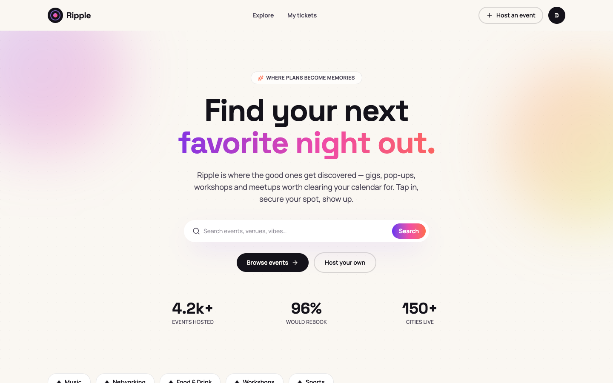
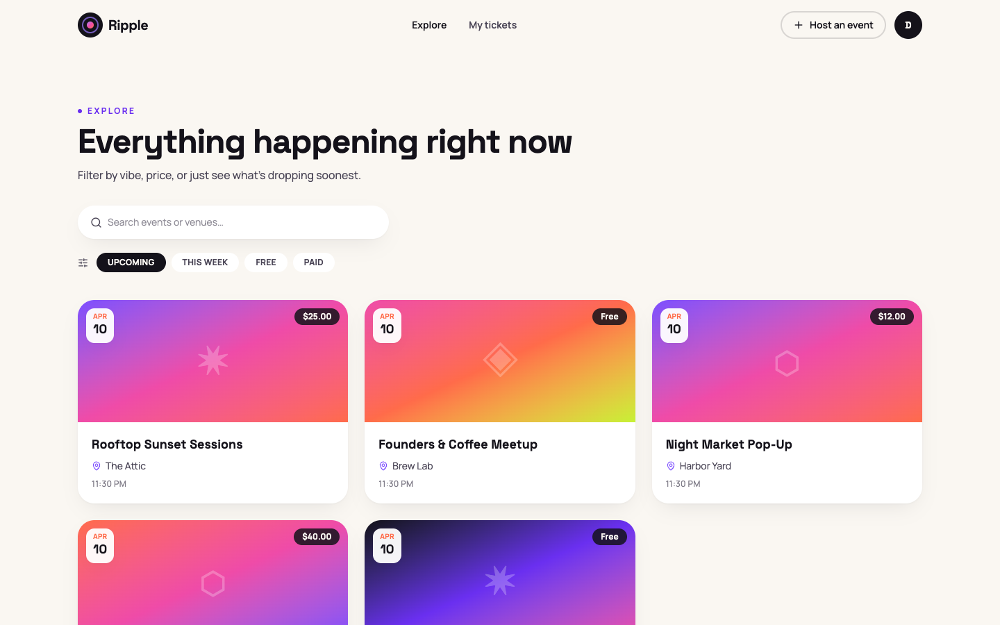
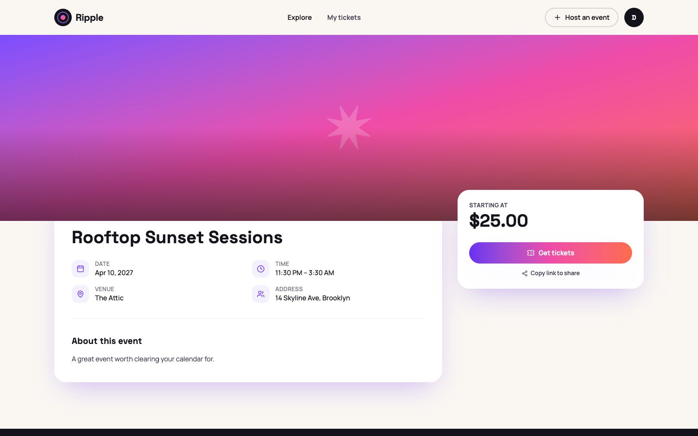
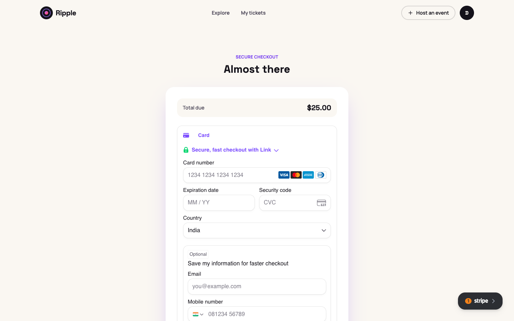
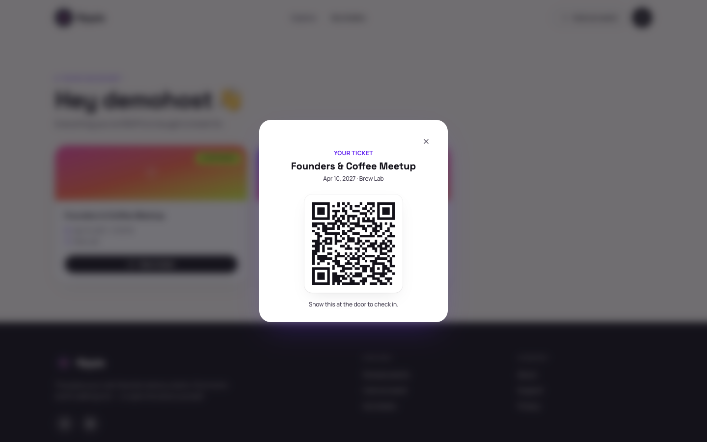

<div align="center">

# Ripple

**A full-stack event ticketing platform** — discovery, paid/free registration, real Stripe payments, QR-coded tickets, and door check-in, with a two-tier permission system built for how events actually run.

[](https://github.com/Kevalnai/Event_Management/actions/workflows/ci.yml)


[Screenshots](#what-it-does) · [Engineering Reference](docs/ENGINEERING_REFERENCE.md) · [API Overview](#api-at-a-glance) · [Quick Start](#quick-start)

</div>

<br>

<p align="center">
  
</p>

<br>

## The problem

Most small-to-mid event registration still runs on duct tape: a Google Form for sign-ups, a spreadsheet to track who paid, a WhatsApp group for updates, and someone manually checking names off a printed list at the door. It works until it doesn't — payments go untracked, the door list is out of date by the time the event starts, and there's no real way to know who's actually confirmed versus who just filled out a form.

**Ripple replaces that with one system**: a host publishes an event, pricing and all; attendees register and pay through a real Stripe checkout; a QR-coded ticket is issued the moment payment clears; and door staff scan that ticket for an instant, server-verified check-in that can't be faked or double-used.

## What it does

| | |
|---|---|
| 🔍 **Discover** | Browse and search live events by vibe, price, or date |
| 🎟️ **Register & pay** | Free events confirm instantly; paid events go through a real Stripe checkout — card details never touch the backend |
| 📱 **QR tickets** | Every confirmed registration gets a unique, scannable QR ticket, viewable from the attendee's dashboard |
| 🚪 **Door check-in** | Staff scan a ticket's QR (or check in manually as a fallback) for an instant, duplicate-proof confirmation |
| 👥 **Delegated roles** | A host automatically becomes their event's admin and can grant `staff`/`volunteer` roles to others — scoped to that one event, not the whole platform |
| 📊 **Real registration data** | Hosts see who's actually registered and paid — not a spreadsheet someone could have edited |

<p align="center">
  
  
</p>
<p align="center">
  
  
</p>

## Why this isn't a CRUD tutorial project

Anyone can wire up a form that writes to a database. What makes this project worth a second look is everything that happens *around* the happy path — the parts that only show up when you actually push a feature until it breaks:

- **The payment flow was verified against the real Stripe test API, not just mocks** — and that caught three bugs that a mocked unit test suite structurally cannot catch (see below). I didn't mark payments "done" until I'd watched a real browser fill a real Stripe card form, confirm a real test charge, receive a real signed webhook, and issue a scannable ticket.
- **Two independent RBAC systems**, not one: a global platform role (`user`/`admin`) and a *per-event* organiser role (`admin`/`staff`/`volunteer`) scoped to a single event. A user can be an admin on one event and have no access at all to another — the kind of access model real multi-tenant event platforms actually need.
- **A security pass that found and fixed real vulnerabilities**, not hypothetical ones: a privilege-escalation bug where any user could self-promote to admin, a user-enumeration leak in password reset, a hardcoded JWT secret with a well-known fallback value, and wide-open CORS — all found by reading the live code critically, not from a checklist.
- **107 automated tests, 94% backend coverage, running on every push** via GitHub Actions with a real Postgres service container — not a one-off local run.
- **Database migrations via Alembic**, round-trip tested (upgrade → downgrade → upgrade) before being trusted, including a real schema-drift fix (a stray column that had silently diverged from the ORM model).

## Engineering challenges I solved

A few of the harder problems this project actually required solving — the ones that separate "it works on my machine" from "it works":

<table>
<tr>
<td width="30%"><strong>Every real card payment would have silently failed</strong></td>
<td>

Unit tests with a mocked Stripe SDK passed. A real browser against Stripe's real test API did not — `stripe.confirmPayment()` was rejected because the PaymentIntent defaulted to Stripe-Dashboard-enabled payment methods that can redirect, and the frontend (correctly, for a single-page app) never supplies a `return_url`. Found only by actually driving the checkout UI end to end; fixed by explicitly disabling redirect-capable methods at PaymentIntent creation, then re-verified with a real test card.

</td>
</tr>
<tr>
<td><strong>A race condition that mocks structurally can't expose</strong></td>
<td>

React's StrictMode double-invokes effects in development — harmless by itself, except it revealed that two near-simultaneous payment-creation requests for the same registration could both pass a "no existing payment" check before either committed, then both receive the *same* PaymentIntent back from Stripe's own idempotency key, crashing the second database insert. The same race is reachable in production from a double-click or a retried request. Fixed by catching the specific conflict and reconciling to the row the other request already created, instead of failing.

</td>
</tr>
<tr>
<td><strong>Unhandled errors were silently breaking CORS</strong></td>
<td>

A genuinely unexpected server error produced a response with no CORS headers at all — because Starlette's catch-all error middleware sits *outside* the CORS layer by default. The browser reported this as a vague "blocked by CORS policy," hiding the real error and risking a leaked stack trace. Diagnosed by tracing the actual ASGI middleware stack, then fixed with a global exception handler positioned inside the CORS layer — a permanent, systemic fix rather than a patch for one endpoint.

</td>
</tr>
<tr>
<td><strong>RBAC that looked complete but was unreachable</strong></td>
<td>

The per-event role system was fully coded — checks, enums, the works — but there was no endpoint that could ever create the first role record, meaning every permission check failed for everyone, including the person who created the event. Fixed by auto-granting the creator admin on their own event and adding the missing endpoint for them to delegate roles to others.

</td>
</tr>
</table>

## Real-world impact

| Before (forms + spreadsheets) | With Ripple |
|---|---|
| Payment status tracked by hand, easy to lose track of who actually paid | Payment status is the source of truth — a registration can't be "confirmed" without a real, webhook-verified Stripe payment |
| Door check-in is a printed list and an honor system | A ticket's QR can be scanned exactly once; a second scan is rejected, not silently allowed |
| Anyone with the form link can see who else registered | Attendee data is only visible to that event's organisers, enforced server-side |
| One admin password shared across every event a team runs | Per-event roles — a volunteer scanning tickets at one event has zero access to any other event's data or payments |

## Tech stack

| Layer | Choice | Why |
|---|---|---|
| Backend | FastAPI (Python 3.14) | Async-ready, typed request/response contracts via Pydantic, automatic OpenAPI docs |
| Database | PostgreSQL + SQLAlchemy + Alembic | Relational integrity for a domain with real transactional guarantees (a payment either confirms a registration or it doesn't) |
| Payments | Stripe (PaymentIntents + webhooks) | Industry-standard, PCI scope stays entirely off this server — card numbers never touch the backend |
| Auth | JWT access tokens + DB-revocable refresh tokens | Stateless verification with real revocation, not just a long-lived token and hope |
| Rate limiting | slowapi, per-route per-IP | Closes the brute-force/abuse surface on every auth and payment endpoint |
| Frontend | React 19 + Vite | Fast dev loop, no meta-framework overhead for a single-page app |
| Styling | Tailwind CSS + Framer Motion | Consistent design tokens, deliberate motion rather than decoration |
| Testing | pytest + Vitest + React Testing Library | 107 tests across both stacks, real Postgres in CI, zero real Stripe calls in the suite |
| CI/CD | GitHub Actions | Both suites run on every push and PR automatically |

## API at a glance

28 endpoints across 5 domains — auth, events (categories, organisers, sessions, registrations, check-ins), payments, tickets, and the QR scanner. Every list endpoint is rate-limited where it needs to be, paginated where it can grow unbounded, and gated by the correct one of the two RBAC systems.

```
POST   /auth/register                              Create an account
POST   /auth/login                                  Get access + refresh tokens
POST   /events/events                                Create an event (auto-admin on it)
POST   /events/{event_id}/register                   RSVP / start a booking
POST   /payments/                                    Create a Stripe PaymentIntent
POST   /payments/webhook                             Stripe → confirm payment (signature-verified)
POST   /tickets/{registration_id}                     Issue a QR ticket
POST   /scanner/scan                                  Check in by QR code
```

The full reference — every endpoint, request/response shape, and auth requirement — is in the [Engineering Reference](docs/ENGINEERING_REFERENCE.md), along with sequence diagrams for the auth and payment flows and the full database ER diagram.

## Quality & testing

```
Backend:   65 tests · 94% statement coverage · pytest + Starlette TestClient
Frontend:  42 tests · Vitest + React Testing Library
CI:        both suites on every push/PR, with a real Postgres service container
```

The payment and ticketing flow was additionally verified live — a real headless browser, a real Stripe test card, a real webhook delivery — because some classes of bug (see above) only exist under real network and concurrency conditions that a mock can't reproduce.

## Quick start

```bash
# Backend
cd backend
python -m venv .venv && source .venv/bin/activate
pip install -r requirements.txt
cp .env.example .env   # fill in your Postgres + Stripe test keys
alembic upgrade head
uvicorn main:app --reload --port 8000

# Frontend
cd frontend
npm install
cp .env.example .env   # fill in your Stripe publishable key
npm run dev
```

Run the tests:

```bash
cd backend && pytest -v --cov=app
cd frontend && npm run test
```

## Project structure

```
backend/
  app/modules/        auth · events · payments · tickets · scanners
                       (each: routes → services → repository → models/schema)
  app/core/            database, rate limiter, model registry
  alembic/             schema migrations
  tests/               65 pytest tests
frontend/
  src/pages/           10 routes — Home, Events, EventDetail, Checkout, Dashboard...
  src/components/      reusable UI primitives + layout
  src/context/         AuthContext
  src/lib/             API client, formatters, Stripe loader
.github/workflows/     CI — backend + frontend, on every push/PR
testing/               recorded test reports
```

## What's next

- Email delivery for tickets and password resets (currently in-app only — no provider wired up yet)
- Frontend test coverage for the remaining pages (Home, Dashboard, CreateEvent, Checkout UI)
- Redis-backed rate limiting for horizontal scaling beyond a single process
- Load testing under real concurrent traffic

---

<div align="center">

Built by **Keval Nai** — [GitHub](https://github.com/Kevalnai)

</div>
