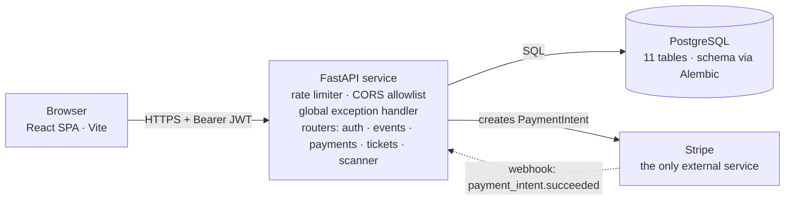
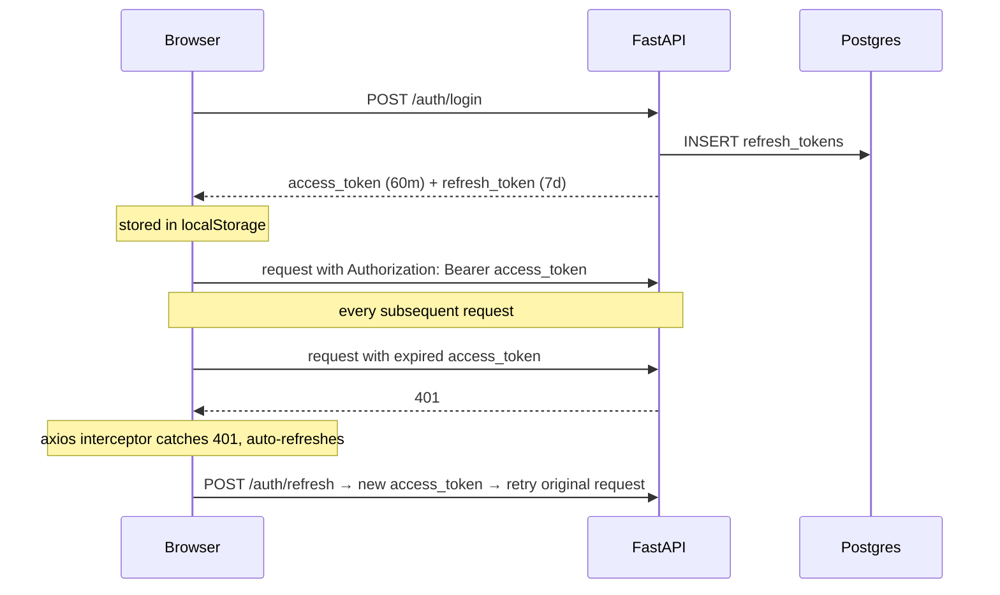
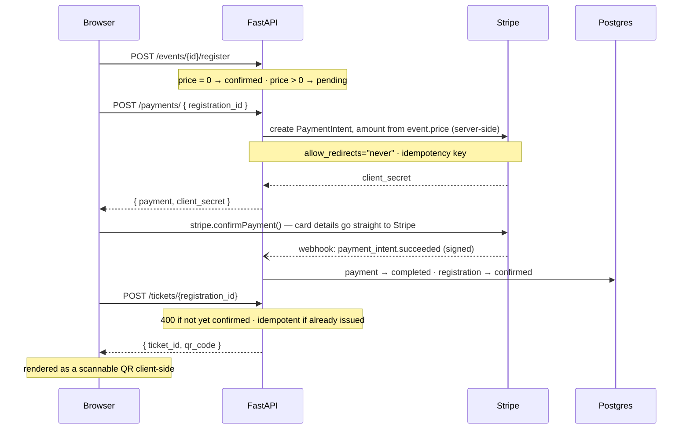
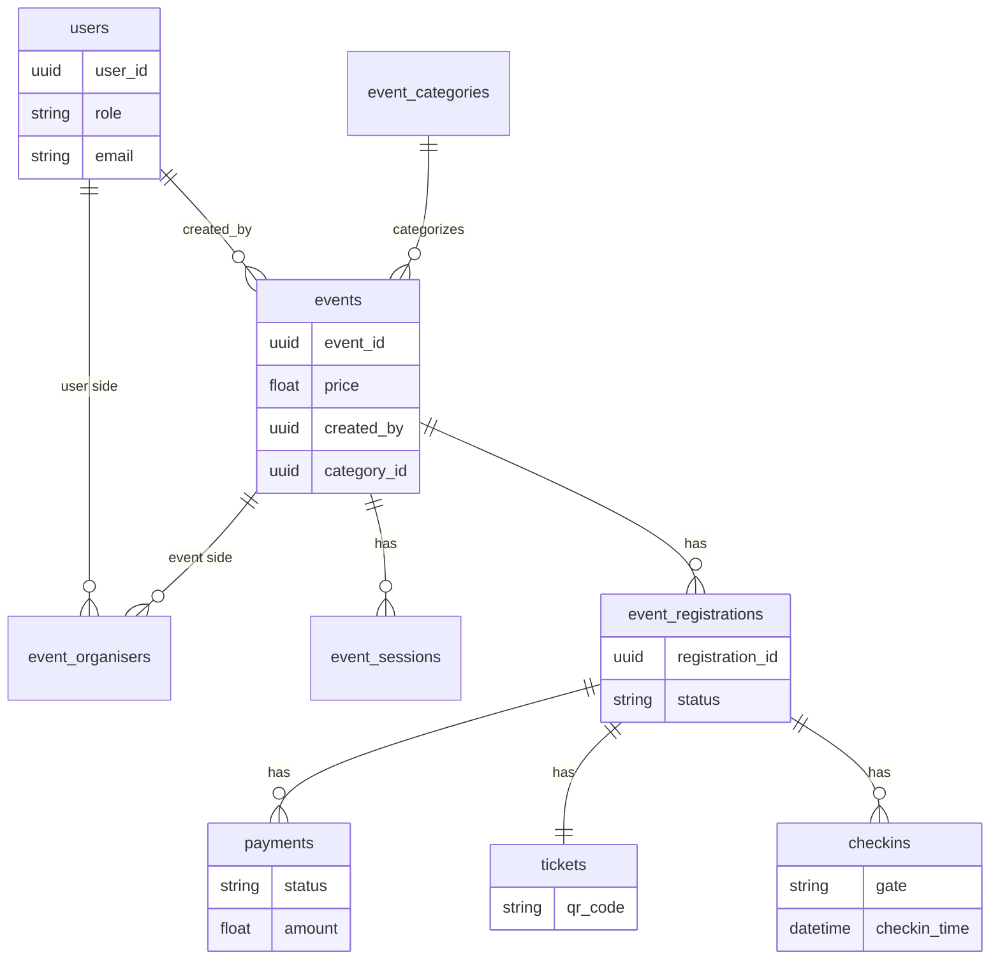

# Ripple — Engineering Reference

The complete technical record of Ripple, an event-ticketing platform: product vision, architecture, data model, API surface, and the real engineering problems solved along the way. Read top to bottom once, then use it as a lookup.

**Stack:** FastAPI (Python 3.14) · React 19 + Vite · PostgreSQL + Alembic · Stripe
**Status:** 107 automated tests (65 backend, 42 frontend), 94% backend coverage, CI on every push, payment flow verified against the real Stripe test API end to end.

---

## Table of contents

- [Part I — Product](#part-i--product)
  - [Overview](#overview)
  - [Personas & user journeys](#personas--user-journeys)
- [Part II — High-level design](#part-ii--high-level-design)
  - [System architecture](#system-architecture)
  - [Non-functional requirements](#non-functional-requirements)
- [Part III — Low-level design](#part-iii--low-level-design)
  - [Codebase tour](#codebase-tour)
  - [Auth & token lifecycle](#auth--token-lifecycle)
  - [Payment & ticket flow](#payment--ticket-flow)
  - [Access control (RBAC)](#access-control-rbac)
  - [Error handling & resilience](#error-handling--resilience)
- [Part IV — Database](#part-iv--database)
  - [Data model](#data-model)
  - [Migrations](#migrations)
- [Part V — Frontend](#part-v--frontend)
  - [Page inventory](#page-inventory)
  - [Components & design system](#components--design-system)
- [Part VI — API reference](#part-vi--api-reference)
- [Part VII — Operations](#part-vii--operations)
  - [Running it locally](#running-it-locally)
  - [Testing & CI](#testing--ci)
  - [Deployment checklist](#deployment-checklist)

---

## Part I — Product

### Overview

Ripple is an event ticketing platform. Hosts publish events — free or paid — attendees discover them, RSVP or pay, and get a QR-coded ticket. Door staff scan that QR to check people in. That's the whole product in one sentence; every system below exists to make that sentence true, secure, and hard to break under real use.

| Role | What they do |
|---|---|
| **Hosts** | Create events, price them, add sessions, invite co-organisers, see who's registered — without a spreadsheet |
| **Attendees** | Browse events, RSVP (free) or pay via Stripe, get a QR-coded ticket on their dashboard |
| **Door staff** | Scan a ticket's QR at the gate, or check someone in manually by registration ID as a fallback |

### Personas & user journeys

Three roles use Ripple, and its two separate RBAC systems (see [Access Control](#access-control-rbac)) exist specifically to serve the second and third without over-trusting either.

**Maya, the Attendee** — end user, no privileges beyond her own bookings.
> "I don't want to dig through five group chats to find out what's happening this weekend — and I definitely don't want to print a ticket."

Journey: Browse → open an event → RSVP → pay if required → land on Dashboard → tap "Get my ticket" → show the QR at the door.

**Dev, the Host** — admin organiser on the events he creates, not a platform admin.
> "I've run this meetup off a Google Form for two years. I just want to know, reliably, who paid and who's actually showing up."

Journey: Create an event (auto-becomes admin organiser) → optionally grants staff/volunteer roles to others → monitors registrations → checks people in himself or delegates to a volunteer.

**Val, the Volunteer** — scoped to one event, lowest-privilege organiser role.
> "I'm at the door for two hours. I need the scan to be fast, and I need it to actually stop the same ticket from getting scanned twice."

Journey: Granted `volunteer` on one event by its admin → scans each arrival → sees a clean confirmation or a rejection if already used → can fall back to manual check-in if a QR won't scan.

---

## Part II — High-level design

### System architecture

A monolith, not microservices: one Python API service, one single-page frontend, one database, one external dependency. No message queue, no background worker, no server-side rendering. The complexity here is in the domain rules and the security surface, not the topology.



Two independently deployable apps sharing one Postgres database, with Stripe as the sole external integration on a synchronous call out and an asynchronous, signature-verified webhook back in.

**Why a monolith:** one team, one data model with tight referential-integrity requirements (a registration's lifecycle touches events, payments, and tickets in the same transaction boundary), nothing that needs independent scaling yet. The module structure inside it (auth, events, payments, tickets, scanner) keeps the boundaries that would matter for a future service split already clean.

**Request path:** every request passes through, in order — CORS middleware (rejects origins not on the allowlist), rate-limit middleware (per-route limits, keyed by client IP), the global exception handler (guarantees any unexpected error still returns a safe, CORS-correct response), then routing to the matching module.

### Non-functional requirements

| Concern | How it's addressed |
|---|---|
| Authentication | Stateless JWT access tokens (HS256, 60 min) + opaque, DB-revocable refresh tokens (7 days). `SECRET_KEY` fails the app at startup if unset — no silent fallback to a known-weak default. |
| Authorization | Two independent RBAC systems — global platform role and per-event organiser role. See [Access Control](#access-control-rbac). |
| Abuse resistance | Per-route, per-IP rate limiting on every auth and payment endpoint (3–30 requests/min depending on sensitivity). |
| Data integrity | Server-derived payment amounts (never trusted from the client), unique constraints backed by explicit conflict handling, foreign keys with `ON DELETE CASCADE` matched at the ORM level. |
| Fault isolation | A global exception handler ensures any unanticipated bug returns a safe, generic error with correct CORS headers and a server-side log entry. |
| Schema evolution | Alembic-managed migrations, round-trip tested (upgrade → downgrade → upgrade) before being trusted. |
| Payment correctness | Verified against the real Stripe test API end to end, including failure modes mocks can't catch — see [Payment & Ticket Flow](#payment--ticket-flow). |
| Scale | Not yet addressed: pagination on only three list endpoints, no caching layer, no load testing, single-process rate limiting. Adequate for current scale, a known next step. |

---

## Part III — Low-level design

### Codebase tour

The backend is organized by domain module, each following the same four-layer pattern:

| Layer | File | Responsibility |
|---|---|---|
| Routes | `routes.py` / `auth.py` | FastAPI decorators, request/response models, dependency injection, rate-limit decorators. No business logic. |
| Services | `services.py` | Business rules, RBAC/ownership checks, orchestration, concurrency/conflict handling. New logic goes here. |
| Repository | `repository.py` | Raw SQLAlchemy queries only. No FastAPI, no business rules. |
| Models / Schema | `models.py` / `schema.py` | SQLAlchemy ORM tables and Pydantic request/response contracts, kept separate so the API shape can differ from the DB shape. |

**Backend modules:** `users` (registration, login, tokens, password reset, global role) · `events` (categories, organiser roles, sessions, registrations, manual check-ins — the largest module) · `payments` (Stripe PaymentIntents and the confirming webhook) · `tickets` (QR ticket issuance) · `scanners` (QR-scan check-in) · `core` (database engine/session, shared rate limiter, model registry).

**Frontend:** `pages/` (one file per route, 10 pages) · `components/layout/` (Navbar, Footer, route guard) · `components/ui/` (Button, Badge, EventCard, and seven more reusable primitives) · `context/AuthContext.jsx` (the logged-in user, wraps the app once) · `lib/` (Axios client with a JWT-refresh interceptor, formatters, Stripe loader). Routing is `react-router-dom`; no meta-framework.

### Auth & token lifecycle

Two token types with different lifetimes and different revocation models, so the frontend never has to ask the user to log in again except after a genuinely expired or revoked session.



**Password policy:** enforced server-side — at least 8 characters, not purely alphabetic or purely numeric. This closed a real gap: the frontend's length hint was cosmetic and trivially bypassed by calling the API directly.

**What's deliberately hard to do:** self-assign a role at registration or via profile update (`role` is not an accepted field on either endpoint), enumerate registered emails via password reset (identical response either way), become the first platform admin without direct database access (by design).

### Payment & ticket flow

The highest-stakes flow in the system, and the one most heavily revised after live browser testing against real Stripe.



The card number never touches the backend; `stripe.confirmPayment()` talks to Stripe directly from the browser. Confirmation of success reaches the backend only via the asynchronous, signature-verified webhook — the frontend's own "success" screen is optimistic UI, not the source of truth.

#### Three bugs live browser testing found that mocks didn't

Unit tests with a mocked Stripe SDK verified the code's logic. They could not catch these, because each depends on real network behavior, real concurrency, or real middleware ordering:

| Bug | Root cause | Fix |
|---|---|---|
| Every real card payment failed at the final step | PaymentIntent creation didn't set `automatic_payment_methods`, so it defaulted to Dashboard-enabled methods including "Link" (redirect-capable). The frontend confirms with `redirect: "if_required"` and no `return_url` — nowhere to redirect back to in a single-page app — which Stripe rejects for any redirect-capable method. | `automatic_payment_methods={"enabled": True, "allow_redirects": "never"}`, verified against the real Stripe API |
| Unhandled exceptions broke CORS and could leak internals | Starlette's `ServerErrorMiddleware` (the catch-all for anything an application handler doesn't catch) sits *outside* `CORSMiddleware`, so its responses never get CORS headers — a browser reports that as "blocked by CORS policy," hiding the real error. | A global exception handler that runs *inside* the CORS layer, logs the real error server-side, and always returns a safe generic message |
| A real race condition in payment creation | Two near-simultaneous requests for the same registration (reachable via a double-click or a retried request) can both pass the "no existing pending payment" check before either commits, then both receive the *same* PaymentIntent from Stripe via the idempotency key — and the second database insert crashes on the unique constraint. | Catch that specific conflict and fall back to the row the other request already created, rather than crash |

**Verified for real, not just tested.** After these fixes, the full flow was driven through an actual browser against Stripe's real test API: registered, RSVP'd, filled Stripe's real card form with a test card, paid, received a genuinely Stripe-signed webhook, watched the registration flip to confirmed, issued a ticket, and scanned its QR at a simulated door — twice, once free and once paid.

**Ticket format and delivery:** a ticket's QR payload is a server-generated unique string, rendered as a scannable QR code client-side. Delivery is in-app only — the attendee logs in, opens their dashboard, and taps "Get my ticket" (a manual action) then "View ticket." There is no email, SMS, or PDF delivery yet — a known product gap, not a bug.

### Access control (RBAC)

Two independent systems answer two different questions. Confusing them is the most common mistake a new engineer makes here.

| | Global role | Event organiser role |
|---|---|---|
| Question it answers | Is this person a platform admin? | What can this person do on *this specific* event? |
| Stored on | `users.role` | `event_organisers.role`, one row per (user, event) |
| Values | `user` / `admin` | `admin` / `staff` / `volunteer` |
| Enforced by | `require_admin` dependency | `RBACService.require_roles()`, called explicitly per action with the event's id |
| Granted by | An existing admin. The first admin requires direct database access — no bootstrap endpoint, by design. | Automatic for the event creator; an admin organiser can grant others. |

**Per-event permission matrix**

| Action | Admin | Staff | Volunteer |
|---|:---:|:---:|:---:|
| Delete the event / grant organiser roles | ✅ | — | — |
| Add sessions / view registrations & organisers | ✅ | ✅ | — |
| Check attendees in (manual or QR scan) | ✅ | ✅ | ✅ |

**Ownership — a third, informal layer:** some actions check whether a resource belongs to the caller, independent of any role — paying for a registration, claiming a ticket.

### Error handling & resilience

| Scenario | Behavior |
|---|---|
| Expected error (bad input, not found, forbidden) | A specific status code with a `{"detail": "..."}` message |
| Rate limit exceeded | `429` with the same error shape as everything else |
| Unique constraint conflict (duplicate event title) | Caught explicitly around the insert, translated to a clean `400` |
| Concurrent duplicate payment insert | Caught explicitly, falls back to the already-created row — see [Payment & Ticket Flow](#payment--ticket-flow) |
| Genuinely unexpected exception | Caught by the global handler: logged server-side, returns a generic `500` with no internal details, correct CORS headers guaranteed |

> **Why the global handler matters architecturally, not just cosmetically.** Starlette's middleware order means an exception that escapes every application-level handler bypasses `CORSMiddleware` entirely. Without the global handler, any future unhandled bug in any endpoint reproduces the exact "blocked by CORS policy" symptom found in payments — the fix is permanent and systemic, not specific to one endpoint.

---

## Part IV — Database

### Data model

11 tables. The diagram covers the 9 that make up the product domain; two pure auth-plumbing tables (`refresh_tokens`, `password_reset_tokens`, both 1:N off `users`) are omitted for clarity.



Highlighted path (events → registrations → payments/tickets/checkins) is the transaction spine the rest hangs off.

**Enums**

| Enum | Values | Lives on |
|---|---|---|
| RegistrationStatus | pending · confirmed · cancelled | `event_registrations.status` |
| PaymentStatus | pending · completed · failed | `payments.status` |
| OrganiserRole | admin · staff · volunteer | `event_organisers.role` |

**Constraints worth knowing:**
- `events.title` — unique. A duplicate is a clean `400`, not a crash.
- `payments.stripe_payment_intent_id` — unique, indexed, protected against concurrent-insert races.
- `tickets.qr_code` — unique.
- All child foreign keys off `events` and `event_registrations` use `ON DELETE CASCADE`, matched at the ORM level — deleting an event cleanly cascades through every dependent row in one database-level operation.

### Migrations

Alembic manages schema changes to any database that already has data in it. `create_all()` remains as a convenience for a brand-new, empty database only — it never alters an existing table.

| Revision | What it does |
|---|---|
| Initial schema | All 11 tables, generated against a genuinely empty database and round-trip tested: upgrade → downgrade → upgrade, twice |
| Schema-drift fix | Dropped a stray column that had drifted out of sync with the model — real drift found and fixed, doubling as a live demonstration that the migration workflow works for incremental changes |

> **A real Alembic gotcha, fixed.** The autogenerated downgrade for the initial migration dropped tables but not the Postgres native enum types they used, so a second upgrade after a downgrade failed with a "type already exists" error. Fixed by adding explicit enum-drop calls to the downgrade — a known limitation of Alembic's enum autogeneration, not something it catches on its own.

---

## Part V — Frontend

### Page inventory

| Route | Access | Purpose |
|---|---|---|
| `/` | Public | Hero, category browse, featured upcoming events |
| `/events` | Public | Full event list with search/filter |
| `/events/:id` | Public | Event info, sessions, RSVP entry point |
| `/login`, `/register` | Public | Auth |
| `/create-event` | Protected | Host flow — becomes admin organiser on submit |
| `/checkout/:registrationId` | Protected | Stripe Elements payment form |
| `/checkout/:registrationId/success` | Protected | Optimistic confirmation screen |
| `/dashboard` | Protected | "My tickets" — registrations, ticket issuance, QR display |

### Components & design system

A small, reused set of UI primitives (Button, Badge, EventCard, Field, Alert, Loader, Logo, Blob, Section) rather than one-off styling per page. Space Grotesk for headings, Manrope for body text, a violet-to-coral gradient as the single bold accent, a warm cream ground chosen deliberately rather than inherited as a default.

**State management:** `AuthContext` (React Context, no external state library) holds the current user. Everything else is local component state or derived directly from an API response.

**API client:** `lib/api.js` wraps Axios with a request interceptor (attaches the bearer token) and a response interceptor (on a `401`, refreshes once and retries — see [Auth & Token Lifecycle](#auth--token-lifecycle)).

---

## Part VI — API reference

28 endpoints across 5 domains. Conventions: `application/json` everywhere except login (form-encoded) and the Stripe webhook (raw payload); errors are `{"detail": "message"}`; rate limits range 3–30 requests/min on sensitive routes; three list endpoints are paginated (`limit`/`offset`, default 50, max 100).

| Method | Path | Auth | Purpose |
|---|---|---|---|
| POST | `/auth/register` | Public · 5/min | Create an account (password policy enforced, role never client-settable) |
| POST | `/auth/login` | Public · 10/min | Exchange credentials for access + refresh tokens |
| POST | `/auth/refresh` | Public (refresh token) · 30/min | New access token |
| POST | `/auth/logout` | Public (refresh token) | Revoke a refresh token |
| GET | `/auth/me` | Authenticated | Current user |
| PATCH | `/auth/me` | Authenticated | Update your own profile (no role field) |
| PATCH | `/auth/users/{user_id}/role` | Admin only | Change another user's global role |
| GET | `/auth/admin-only` | Admin only | Reference admin-gated route |
| POST | `/auth/password-reset/request` | Public · 3/min | Issue a reset token (no email enumeration) |
| POST | `/auth/password-reset/confirm` | Public · 10/min | Consume the reset token |
| POST | `/events/categories` | Authenticated | Create a category (idempotent by name) |
| GET | `/events/categories` | Public | List categories |
| GET | `/events/` | Public | List events, paginated |
| GET | `/events/{event_id}` | Public | Event detail (excludes attendee PII) |
| POST | `/events/events` | Authenticated | Create an event (creator auto-granted admin) |
| DELETE | `/events/events/{event_id}` | Admin organiser | Delete an event (cascades) |
| POST | `/events/{event_id}/organisers` | Admin organiser | Grant an organiser role |
| GET | `/events/{event_id}/organisers` | Admin or staff | List organisers |
| POST | `/events/events/{event_id}/sessions` | Admin or staff | Add a schedule item |
| POST | `/events/{event_id}/register` | Authenticated | RSVP / start a booking |
| GET | `/events/{event_id}/registrations` | Admin or staff | List an event's registrations, paginated |
| GET | `/events/me/registrations` | Authenticated | Your own bookings, paginated |
| POST | `/events/events/{event_id}/checkins/{registration_id}` | Admin, staff, or volunteer | Manual check-in |
| POST | `/payments/` | Authenticated + owner · 10/min | Start or resume checkout |
| POST | `/payments/webhook` | Stripe only (signature-verified) | Confirm payment |
| POST | `/tickets/{registration_id}` | Authenticated + owner | Issue a QR ticket (idempotent) |
| POST | `/scanner/scan` | Admin, staff, or volunteer of the ticket's event | Check in by QR code |

---

## Part VII — Operations

### Running it locally

```bash
# Backend
cd backend
source .venv/bin/activate
uvicorn main:app --reload --port 8000

# Frontend
cd frontend
npm install
npm run dev
```

For real webhook delivery during development:

```bash
stripe listen --forward-to localhost:8000/payments/webhook \
  --events payment_intent.succeeded,payment_intent.payment_failed
```

Paste the printed webhook secret into `STRIPE_WEBHOOK_SECRET`. Free events skip this entirely — they confirm instantly without touching Stripe.

### Testing & CI

107 tests (65 backend, 42 frontend), 94% backend statement coverage. Both suites run automatically on every push/PR via GitHub Actions, with a real Postgres service container for the backend job. The backend suite runs against a dedicated test database, truncated before every test, with every Stripe call mocked — except the payment/ticket flow, which was additionally verified live against the real Stripe test API (see [Payment & Ticket Flow](#payment--ticket-flow)).

### Deployment checklist

| Item | Status |
|---|---|
| CORS, rate limiting, password policy, fail-fast secrets | Done |
| Payment flow verified against real Stripe | Done |
| Database migrations (Alembic) | Done |
| CI | Done |
| Swap to live Stripe keys | Deploy-time action |
| Permanent webhook endpoint + secret | Deploy-time action |
| `ALLOWED_ORIGINS` set to the real domain | Deploy-time action |
| Email delivery for tickets / password reset | Not built yet |
| Horizontal scaling (Redis-backed rate limiting) | Not needed yet |
